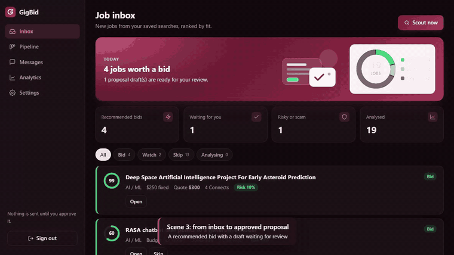
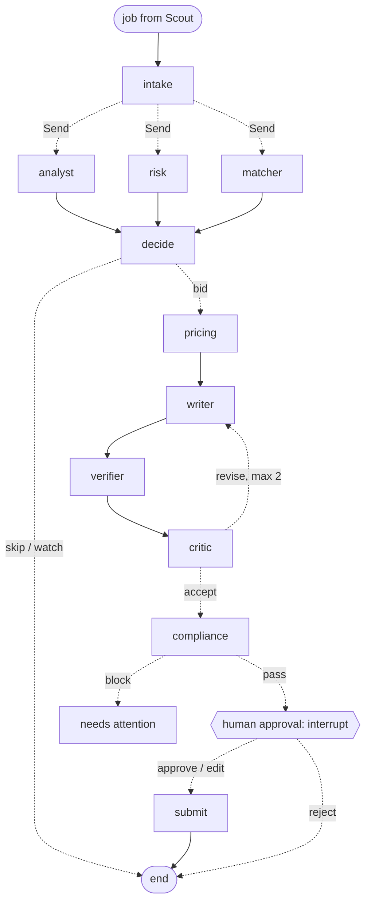

# GigBid: a multi-agent freelancer copilot

GigBid finds freelance jobs, checks whether they are worth a bid, writes proposals in which
every claim links to real portfolio evidence, and drafts replies to clients. **Nothing is sent
until you approve it.** It runs against the GigSim marketplace simulator and, through the same
port, against Upwork's official MCP server.



> 3-minute demo video: _add the YouTube/Drive link here_ (recorded with `node apps/web/scripts/record_demo.mjs`)
> Live app: _add the Hugging Face Space URL here_ · reviewer login is shared privately
> Public traces: _add three LangSmith/Langfuse share links here (scam skipped, approved
> proposal with a Critic loop, crash-and-resume)_

## What it does

1. **Scout** runs your saved searches on a schedule and drops reposts and near-duplicates.
2. **Job Analyst, Risk Assessor and Fit Matcher run in parallel.** You get a typed JobSpec, a
   risk report (scams, off-platform asks, free-work requests, injected instructions) and a
   requirement-to-evidence matrix.
3. **Bid, watch or skip**, with reasons. For a bid, the **Pricing Strategist** quotes inside the
   client's range, never under your floor, and checks whether the Connects cost is worth it.
4. The **Proposal Writer** drafts with evidence tags; **claim verification** removes any sentence
   the portfolio does not support; the **Critic** sends weak drafts back (at most twice); the
   **Compliance Guard** enforces the policy pack.
5. **You approve, edit or reject** in the Proposal Studio (evidence on hover, dry-run preview of
   what will be sent and what it costs). Approval submits exactly once, even after a crash.
6. **Client Liaison** classifies replies, offers interview slots from your calendar and drafts a
   response, behind the same approval gate. Your edits teach **style memory**; outcomes teach
   **outcome memory**, each only through an explicit promotion rule.

## Architecture



* Agents call only **MCP tools**: our Portfolio, Marketplace and Workspace servers, plus
  Upwork's official server (live mode) and GitHub's (repo ingestion). See [docs/TOOLS.md](docs/TOOLS.md).
* **One marketplace port** with GigSim, live Upwork and fake adapters, chosen by `marketplace.mode`.
* **Durable**: Postgres (or SQLite) checkpointer; approvals live in the checkpoint.
* **Config, not code**: every model, threshold, Connects rule, risk signal and banned phrase is in
  [agent/config.yaml](agent/config.yaml) or `data/policy_pack/`; every prompt is in `agent/prompts/`.

Details: [docs/ARCHITECTURE.md](docs/ARCHITECTURE.md) · decisions: [docs/adr/](docs/adr/) ·
operations: [docs/RUNBOOK.md](docs/RUNBOOK.md) · data: [docs/DATA_CARD.md](docs/DATA_CARD.md).

## Results

Every number below is generated from `evals/results/*.json` by
`python -m evals.runners.results_table`. Dev set: about 200 jobs per persona with gold labels
(rule-derived; see the data card for how and for their limits). Models: open weights only
(bge-small embeddings, ms-marco MiniLM cross-encoder, gpt-oss on Groq for the hosted profile,
qwen2.5 3B locally).

<!-- results:start -->
### Headline (B5)

| Variant | Evidence Recall@5 | nDCG@10 | Unsupported claims per proposal (after verification) | GigSim reply rate | p95 latency (s) | Cost per proposal (USD) |
|---|---|---|---|---|---|---|
| V0 (naive dense retrieval) | 0.3032 | 0.2973 | not run | not run | 1.0418 (retrieval only) | 0.0 |
| Shipped: V4 + LLM writer + verification | 0.5666 | 0.536 | 0.0 | 0.0345 | 37.9 (one proposal, demo_proposal.json) | 0.0 (Groq free tier) |

### Retrieval variants (dev set, all personas)

| Variant | Evidence Recall@5 | MRR | nDCG@10 | p95 retrieval latency (s) |
|---|---|---|---|---|
| V0 naive | 0.3032 | 0.3591 | 0.2973 | 1.0418 |
| V1 decomposition | 0.2756 | 0.3381 | 0.2928 | 2.2933 |
| V2 hybrid | 0.347 | 0.4221 | 0.3471 | 0.9077 |
| V3 rerank | 0.3766 | 0.4281 | 0.3495 | 6.805 |
| V4 outcome **(shipped)** | 0.5666 | 0.6598 | 0.536 | 1.07 |
| V5 multi-vector | 0.3032 | 0.3608 | 0.2973 | 0.9343 |
| V8 corrective | 0.0349 | 0.0423 | 0.032 | 23.3613 |
| V1+V2 | 0.3129 | 0.3678 | 0.3214 | 7.3677 |
| V1+V2+V3 | 0.3258 | 0.4018 | 0.3512 | 7.7256 |
| V1+V2+V3+V4 | 0.366 | 0.4603 | 0.3871 | 6.835 |
| V2+V3 | 0.38 | 0.4247 | 0.3504 | 7.1125 |
| V2+V4 | 0.4681 | 0.6654 | 0.4903 | 0.6722 |
| V1+V2+V4 | 0.4734 | 0.5965 | 0.4856 | 1.4318 |

### By persona

| Persona | V0 Recall@5 | V4 Recall@5 | V0 nDCG@10 | V4 nDCG@10 |
|---|---|---|---|---|
| ai_ml | 0.2021 | 0.4385 | 0.2417 | 0.4702 |
| fullstack | 0.2972 | 0.6255 | 0.2806 | 0.5296 |
| data_analyst | 0.3957 | 0.6172 | 0.3614 | 0.5986 |

### Decisions (dev set, shipped config)

| Persona | Bid/skip F1 | Scam precision | Scam recall | Injection detection recall | Price in fair band | p95 s per job analysed |
|---|---|---|---|---|---|---|
| ai_ml | 0.6265 | 0.8889 | 0.8 | 1.0 | 0.6053 | 1.998 |
| fullstack | 0.4507 | 0.6667 | 0.8 | 1.0 | 0.625 | 1.769 |
| data_analyst | 0.3684 | 1.0 | 0.8 | 1.0 | 0.6333 | 1.922 |

### R&D A: tool granularity

| Tool set | Tools | Tool-selection accuracy | Argument accuracy | Tokens per task |
|---|---|---|---|---|
| fine | 26 | 0.9 | 0.9 | 736.8 |
| coarse | 3 | 0.85 | 0.85 | 418.7 |
| best | 11 | 0.975 | 0.975 | 679.9 |

Model: openai/gpt-oss-20b, 40 tasks.

### R&D C: single agent vs supervisor vs hand-built graph

| System | Bid/skip accuracy | Unsupported claims per proposal | Compliance violations left | Planted scams/injections handled | Tokens per job | p50 s |
|---|---|---|---|---|---|---|
| a_react | 0.6667 | 1.667 | 0 | 3/4 | 2643.2 | 8.2 |
| b_supervisor | 0.6667 | 2.667 | 0 | 3/4 | 6618.1 | 39.3 |
| c_graph | 0.75 | 0.0 | 0 | 3/4 | 1472.2 | 1.5 |

All LLM calls: openai/gpt-oss-20b; persona ai_ml.

### Signature extension X2: proposal A/B test in GigSim

| Arm | Proposals | Replied or better | Reply rate | Interview or hired | Mean words |
|---|---|---|---|---|---|
| A_llm | 29 | 1 | 0.0345 | 1 | 90.8 |
| B_template | 30 | 2 | 0.0667 | 2 | 48.6 |

Fisher's exact test p = 1.0 (two-sided).
<!-- results:end -->

**What ships and why.** Outcome-aware ranking (V4) had the best Recall@5, MRR and nDCG@10 and
is cheap, so it ships (ADR 0002). Hybrid search and reranking each helped on their own but
added nothing on top of V4. The corrective loop (V8) is not shipped: the cross-encoder's grade
did not separate relevant from irrelevant evidence on this corpus
(`evals/results/v8_calibration.json`), so the loop refused almost every job. Better retrieval
also exposed a grounding risk: past proposals ranked high and the writer cited them as proof,
so claim verification now accepts only CV, case study, repo, code and review evidence.

**Threats to validity.** Gold labels and the synthetic past proposals are rule-derived from
skill overlap, which favours lexical matching and V4. GigSim's client rule is simulated. The
local 3B model runs at about 1 token/s on the test laptop (`evals/results/llm_speed.json`), so
local proposals miss the 90 s budget; the hosted profile is used for the deployed app.

## Quick start

```bash
cp .env.example .env            # fill in the empty values (never commit .env)
docker compose -f infra/docker-compose.yml --env-file .env up --build
# web http://localhost:3000 · API http://localhost:8000/docs
```
Without Docker: see [docs/RUNBOOK.md](docs/RUNBOOK.md). Tests: `pytest -q` and
`cd apps/web && npx playwright test`. Evaluations: `make eval`, PR gate `make eval-smoke`.

## Repository map

| Path | What |
|---|---|
| `agent/` | graphs, nodes, state, hand-offs, memory, prompts, config, MCP client, marketplace port |
| `rag/` | ingestion, index, variants V0–V5 and V8, retriever factory, claim verification |
| `mcp_servers/` | portfolio, marketplace (GigSim and Upwork adapters), workspace |
| `apps/api`, `apps/web` | FastAPI backend, React + TypeScript frontend (client generated from OpenAPI) |
| `worker/` | Arq worker: scheduled scouting, idempotent runs, queued retries |
| `evals/` | dev datasets, runners, committed results |
| `gigsim/` | marketplace simulator (not modified by the agent code) |

## Pinned stack

Python 3.12, LangGraph 1.2.22, langchain-mcp-adapters 0.3.2, MCP SDK 1.30.0, FastAPI 0.163.0,
sentence-transformers 6.3.0, React 18.3.1, Vite 5.4.8, Playwright 1.47.2 (all pins in
`pyproject.toml` and `apps/web/package.json`).

## Responsible use

GigBid never sends anything without your approval, never scrapes, never uses browser automation
or session cookies, and in live mode only creates drafts that you confirm on Upwork. Job posts
and client messages are treated as untrusted data. AI assistance is disclosed in
[docs/AI_USAGE.md](docs/AI_USAGE.md).
