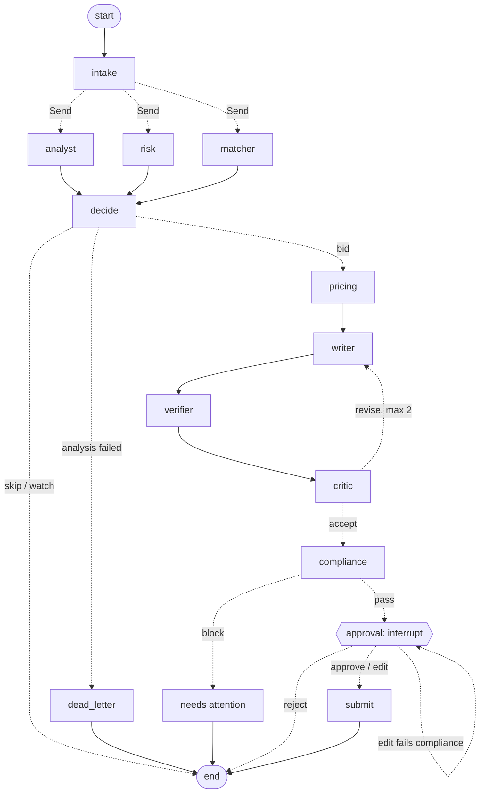

# Architecture

GigBid is a web app (React) over an API (FastAPI) that drives two LangGraph graphs. Agents
reach the outside world only through MCP tools; the marketplace is one port with three
adapters (GigSim, live Upwork, fake). Nothing reaches a client until a human approves it.

```
 React (Vite, TS)  --REST + SSE-->  FastAPI  --astream/interrupt-->  Bid graph / Conversation graph
                                       |                                   |   (Postgres or SQLite checkpointer,
                                       |                                   |    LangGraph store for memory)
                                  Arq worker (Redis)                       v
                                  scheduled scouting            agent/mcp_client.py (per-agent allowlists)
                                                                    |            |              |
                                                          Marketplace MCP   Portfolio MCP   Workspace MCP
                                                                    |            |  (RAG: rag/)
                                                     marketplace port -> GigSim | Upwork MCP | fake
```

## Bid graph (one thread per job)

Rendered from code (`agent/graphs/bid_graph.py`, `docs/images/bid_graph.mmd`):



* **Parallel analysis**: `intake` fans out with `Send` to Job Analyst, Risk Assessor and Fit
  Matcher; they write `analyses`, `evidence` and `counters` through reducers
  (`agent/state.py`), so parallel writes never overwrite each other. `status` has no reducer
  on purpose: only sequential nodes may set it.
* **Loops with limits**: the Critic can send a draft back at most `budgets.critic_max_loops`
  (2) times; every node is wrapped by `guarded` (step and token budget -> `needs_attention`,
  retries with backoff -> `dead_letter`).
* **Human in the loop**: `approval` calls `interrupt()` with the draft, the evidence behind
  every claim, the risk report, the price rationale, the compliance verdict and the
  marketplace `dry_run` preview. Edits are re-checked by Compliance and recorded as style
  candidates; rejections need a reason.
* **Exactly once**: `submit` uses idempotency keys derived from the thread id
  (`<thread>:draft`, `<thread>:submit`). After a crash the node replays and the marketplace
  returns the stored result instead of submitting or spending Connects again
  (`tests/integration/test_bid_graph.py::test_bid_approve_crash_resume_submits_once`).

## Conversation graph (one thread per client conversation)

`read -> classify -> (scam_signal: flag) | (interview_request: slots) -> draft -> compliance ->
approval [interrupt] -> send` (`agent/graphs/conversation_graph.py`). Sending and the calendar
hold use write tools that the liaison may call only after approval.

## State, trace and memory are kept apart

| | Where | Written by | Lifetime |
|---|---|---|---|
| State | `BidState` / `ConversationState` fields (job, analyses, evidence, decision, price, drafts, critiques, approvals, outcomes) | nodes, through reducers | one thread |
| Execution trace | `trace` (append-only `TraceEvent` list: node, tool, masked arguments, result, duration, tokens) + MCP audit log | every node and tool call | audit; never fed to memory |
| Long-term memory | LangGraph store namespaces `("memory", user, "style" \| "outcome")` | only `agent/memory/promotion_rules.py` | across threads |

Promotion rules: a style pattern needs `memory.style.min_edits_to_promote` (3) distinct
proposals; an outcome lesson needs `memory.outcome.min_samples_to_promote` (10) outcomes and
a reply-rate gap of at least 0.05. Users can see and delete both in Settings.

## Why each agent exists

| Agent | Why it is separate | Model / method |
|---|---|---|
| Scout | Scheduling, dedup and rate limits are not reasoning; isolating them keeps polling polite | no LLM; fingerprint dedup |
| Job Analyst | Turns untrusted text into a typed `JobSpec` that later steps decide on | rules (default) or the analyst model |
| Risk Assessor | Scam and injection checks must run before anything is drafted, and in parallel | rules from `config.risk_rules` + client history |
| Fit Matcher | Requirement-to-evidence mapping is retrieval, not generation | Portfolio MCP (`search_evidence`) + cross-encoder grade |
| Pricing Strategist | Money and Connects decisions must be explainable and floor-bounded | market percentiles, client range, user floor, EV per Connect |
| Proposal Writer | The only free-text generator; strongest model | writer model with evidence tags; template fallback |
| Claim verifier | Removes unsupported claims before the Critic (R5) | `rag/verify.py` (cross-encoder + exact numbers and tools) |
| Critic | Independent check of grounding, personalisation and length | rules, plus critic model when rules pass |
| Compliance Guard | Platform rules must be deterministic and auditable | policy pack, banned phrases file, PII masking |
| Client Liaison | Different thread lifetime (a conversation, not a job) | liaison model, Workspace MCP |

## The marketplace port

`agent/marketplace_port.py` defines `MarketplacePort`; `marketplace.mode` in config picks the
adapter by import string, so switching GigSim to live Upwork is a config edit. Every write
takes an idempotency key and a `dry_run` flag. The GigSim adapter adds a token bucket,
bounded exponential backoff and a circuit breaker; when the breaker is open the API reports
`marketplace: unavailable`, runs are parked as `queued`, and `retry_queued` resumes them.

## Change request readiness

Rules that a "platform policy update" could change live in config or data, not code:
Connects cost tiers and flat cost (`platform_rules.connects`), weekly budget, service fee,
banned phrases (`data/policy_pack/banned_phrases.txt`), off-platform terms, risk signals and
weights (`risk_rules`), fit and scam thresholds, rate floor ratios, and every prompt
(`agent/prompts/*.md`). GigSim's own current cost is also read from each job at pricing time.
